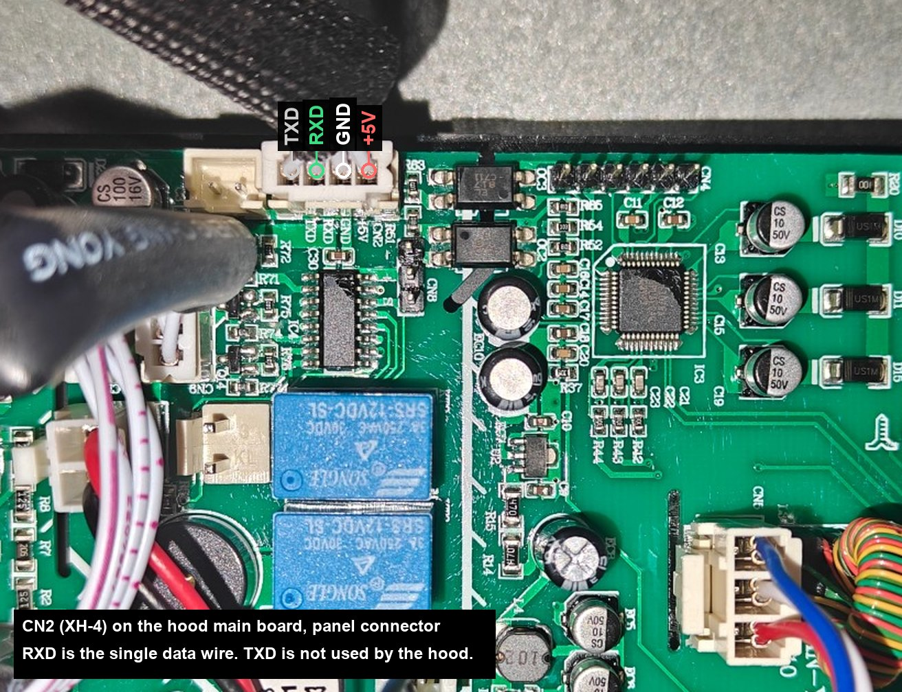
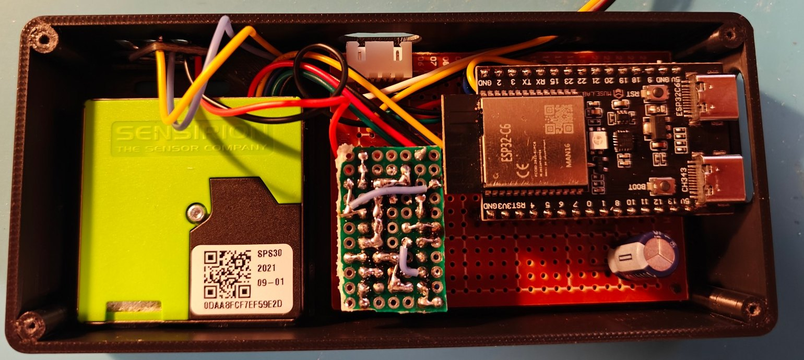
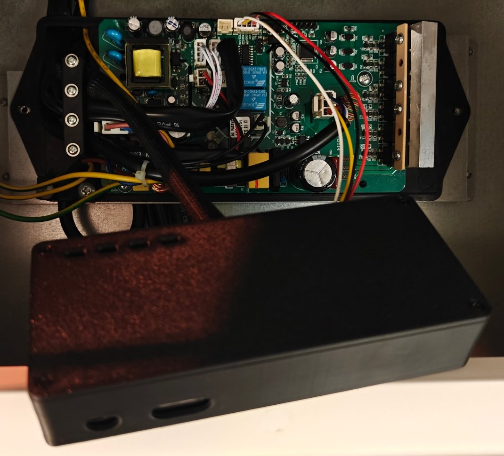
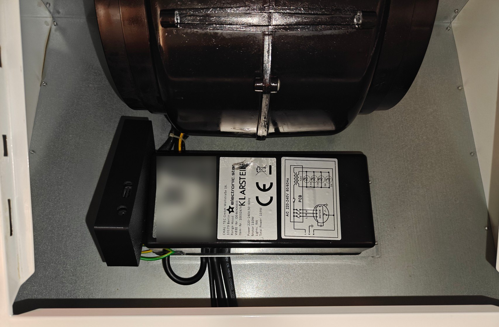

# Range hood to Home Assistant: ESP32-C6 between the touch panel and the main board

Adds local Home Assistant control to a Klarstein Aurora range hood (glass touch panel with on/off, plus, minus and
light buttons) without touching mains. An ESP32-C6 sits in the low-voltage cable between the touch panel and the hood's
main board. It relays the panel's commands, lets Home Assistant override the fan and lights, and reads the motor
feedback. The hood keeps working from its own panel, with or without Home Assistant.

Tested on one unit only. Other hoods with the same panel may behave the same, but that is not verified.

## What you get

- Fan with 3 speeds, downlight, and an RGB-style backlight with 9 colours, all controllable from Home Assistant
- The state of the panel (fan level, lights, colour, buttons lit) and the motor feedback
- Power and energy estimates, per part (fan, downlight, backlight) and in total
- Optional: SPS30 particulate sensor and AHT10 temperature / humidity on the same board

Everything is local: ESPHome native API, no cloud. Entity examples are in [ha_entities.md](ha_entities.md).

## How it works

The panel and the main board talk over one wire (5 V idle) in short frames:

- **Frame A, panel to hood:** 48 bits carrying fan level, downlight, backlight colour and a checksum
- **Frame B, hood to panel:** 32 bits carrying the motor feedback, sent within about 3 ms of frame A

A small harness board sits between the hood's CN2 connector and the panel plug. It splits the data wire, so the two halves are joined only by the ESP32:

```
hood main board (CN2) --- interface --- ESP32-C6 --- interface --- touch panel plug
```

The ESP forwards frame A from the panel to the hood and rewrites it while Home Assistant overrides the state. The
override ends when someone touches the panel or the "Follow Panel" button is pressed. The panel expects frame B within
a few milliseconds, which a store-and-forward relay cannot meet, so the ESP answers the panel itself with the last
decoded motor feedback. The hood's real frame B is only decoded. The full frame layout is in the header comment of
[esphome/range-hood.yaml](esphome/range-hood.yaml).

Power, ground and the panel's TX wire pass straight through.

## Hardware

- ESP32-C6 board, powered from the 5 V on the hood's CN2 connector
- Interface per line, built on a small perfboard module: a 100 k / 220 k divider for receiving (5 V to 3.4 V) and a BC337
  NPN with a 10 k base resistor and a 100 k base-to-emitter resistor for transmitting. The panel side also has a 15 k
  pull-up to 5 V, because it is separated from the hood board's own pull-up.
- JST-XH 4-pin pigtail onto CN2 and a right-angle XH header for the panel plug
- Printed case, 133 x 58 x 26 mm, with room for the SPS30 and AHT10

Pins: GPIO18 RX hood line, GPIO19 TX hood line, GPIO20 RX panel line, GPIO21 TX panel line, GPIO22 SDA, GPIO23 SCL.

The parts list is in [BOM.md](BOM.md).

## Photos

CN2 on the hood main board. TXD is not used by the hood, RXD carries the single data wire:



The finished harness in its printed case, with the ESP32-C6, the interface module and the SPS30:



The case next to the hood main board, with the pigtail plugged into CN2:



The hood interior with the controller box and the rating plate (110 W motor, 9 W lights). The QR code and serial number are blurred:



## Files

| Path | Content |
|---|---|
| [system_overview.svg](system_overview.svg) | Block diagram: hood board, panel, interface, ESP32-C6, sensors |
| [interface_schematic.svg](interface_schematic.svg) | Circuit of the interface: receive divider and transmit transistor per line |
| [BOM.md](BOM.md) | Bill of materials |
| [esphome/range-hood.yaml](esphome/range-hood.yaml) | ESPHome firmware |
| [esphome/secrets.yaml.example](esphome/secrets.yaml.example) | Secrets the firmware expects |
| [ha_entities.md](ha_entities.md) | Home Assistant entities with example values |
| [case/](case) | STL files for the case bottom and lid |
| [photos/](photos) | Photos of the hood, the main board connector and the build |

## Build and flash

1. Build the interface module and the main board from the schematic and the BOM. Check the resistance between the
   lines and ground before powering anything.
2. Copy `esphome/secrets.yaml.example` to `secrets.yaml` and fill it in.
3. Flash `range-hood.yaml` over the ESP32-C6's native USB port. Later updates go over the air.
4. With the panel unplugged the hood beeps continuously, because it sees no panel. Plug the panel into the ESP's
   panel header and the beeping stops.
5. Insert the pigtail into CN2 and add the device in Home Assistant.

## Limits

- The touch panel shows only its own touch state. It ignores frame B, so an override from Home Assistant is never
  shown on the glass.
- Backlight colour code 5 (lime) is indistinguishable from code 9 (yellow-green), so both show as yellow-green.
- The power figures are a measured model, not a live measurement. They match a plug meter within about 0.5 W on the
  tested hood.
- Turning the fan on takes about 12 s to reach speed. Motor feedback shows the ramp.

## Safety

Only the hood's low-voltage panel cable is touched: 5 V, ground and the data wire. Do not open or modify anything on
the mains side. Unplug the hood before opening it, and check the connector pinout on your own unit before connecting
anything. You do this at your own risk.
